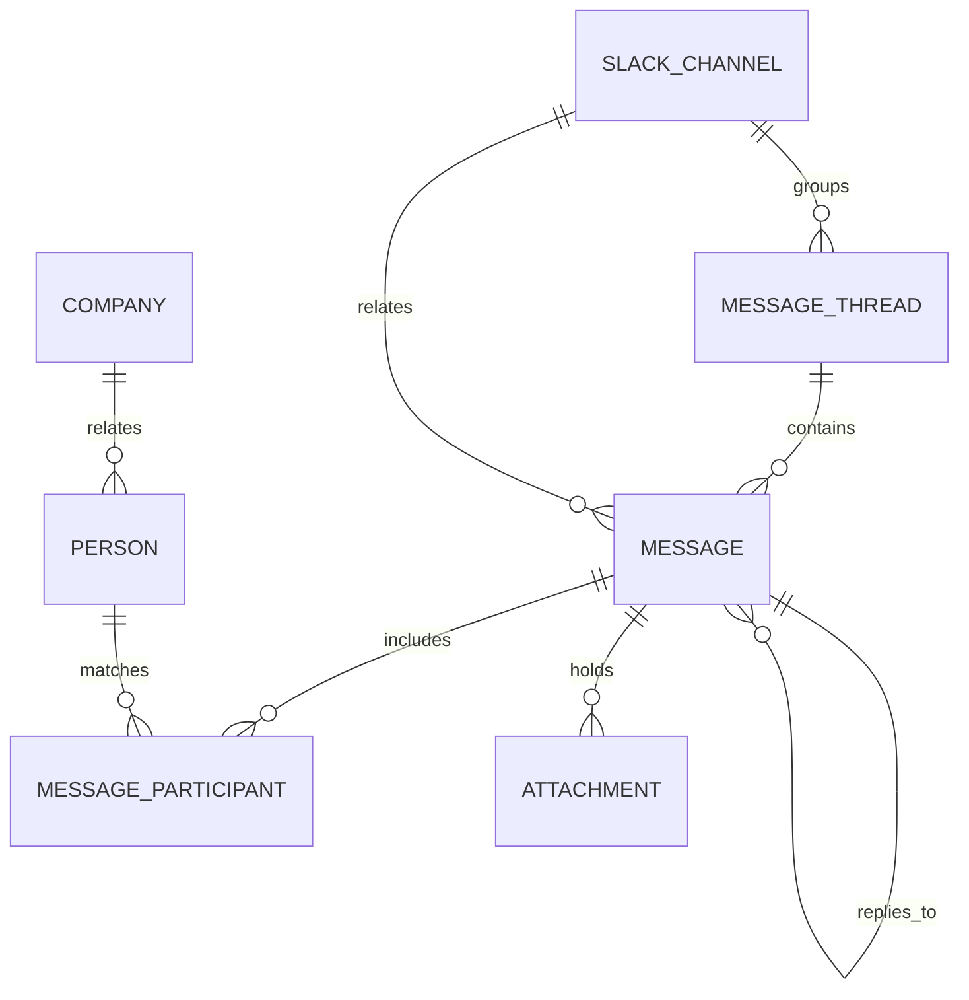

# Slack sync

Updated 2026-11-21. This documents the Slack MVP in this branch and its local preview, not a production rollout. Owner choices and their exchanges are recorded in the [Slack decision index](decisions/slack/DECISIONS.md). The app's [README](../packages/twenty-apps/internal/slack-sync/README.md) owns installation details and required scopes.

## Current state

The VM preview runs the Twenty fork with the Slack app installed. Native channel/thread/message browsing, record Slack tabs, files, message formatting, sharing, and configurable contact creation are implemented. Synthetic tests and a private import of the actual #posthog channel are available.

The source branch integrates main's Twenty 2.61 changes. The existing VM preview remains isolated on its verified 2.60 snapshot; it does not verify the merged 2.61 runtime. See the [main integration handoff](handoffs/2026-11-21-slack-main-integration.md) for conflict resolutions and fresh checks.

The #posthog import contains **77 distinct messages in 14 conversations**: five multi-message threads and nine standalone posts. This is a connected-tool snapshot. It does not give the installed app a Slack OAuth token; continuous history import and event sync still need the app's own authorization. The linked Scalekit channel's membership was inspected to explain multiple-lead behavior; that channel was not imported.

No commit, push or production deployment is implied by an implementation or test result in this document.

## Product entry points

| Surface                                 | Behavior                                                                                    |
| --------------------------------------- | ------------------------------------------------------------------------------------------- |
| Sidebar → Slack                         | Channels, Threads and Slack Messages are native object views.                               |
| Person → Slack                          | Conversations linked through matched channel participants, grouped by channel.              |
| Company → Slack                         | Conversations from related People, grouped by channel and deduplicated by native thread ID. |
| Thread side panel                       | Native read-only conversation, with files, reactions, edit/delete markers and source links. |
| Apps preferences → Slack Sync → General | Native per-member Slack connection flow.                                                    |
| Apps preferences → Slack Sync → Sync    | Contact creation policy, exclusions, employee domains and history import.                   |

The preferences route is `/settings/app-preferences/<applicationId>`. The UI uses the native email settings pattern: policy radio cards, switch rows, native inputs/buttons/selects and theme tokens. Policy and exclusion changes save immediately. Employee domains have a separate Save action. With no usable connection, history shows a connection prompt rather than empty selectors.

A standalone post shows its body once with `1 message`. Replies promote the same item into a multi-message thread; they do not create a second root post. Channel headings distinguish thread counts from standalone-post counts. Opening an item uses Twenty's existing side panel. Group summaries currently refresh manually; the open native thread uses existing subscriptions.

## Data model

`slackChannel` is app-owned. `message`, `messageThread`, participants and attachments are native Twenty records. The provider's ingestion channel is a per-connected-account sync/sharing boundary; a Slack conversation is represented by a message folder and its app-owned Slack Channel record. These are different concepts.

| Record                    | Added fields / metadata                                                                                             |
| ------------------------- | ------------------------------------------------------------------------------------------------------------------- |
| Message                   | `slackMessageId`, `slackChannel`, `slackReplyToMessageId`, `slackReplyTo`, `slackReplies`, `slackAttachmentStatus`. |
| Message Thread            | `slackThreadId`, `slackChannel`.                                                                                    |
| Message provider metadata | Slack permalink, reactions, edit/delete timestamps and update revision.                                             |
| Slack Channel             | Slack workspace/channel identity, name, conversation type, Slack Connect status and native message-folder binding.  |

Canonical identity is `teamId:channelId:timestamp`. A thread uses the root timestamp; a reply keeps its own message timestamp and the root's thread timestamp. The root has no parent relation. Out-of-order replies are repaired when their parent arrives. A provider opt-in makes identity shared across members' connections, so syncing the same Slack message through two members does not create two records. Each connection still retains its own channel association and sharing boundary.

Conversation type values are `CHANNEL`, `DM`, and `GROUP_DM`, shown as Channel, Direct message and Group direct message.

## Multiple leads and companies

The mapper includes the sender plus current channel members. The sender is `FROM`; other members are `TO`. It matches Slack profile emails to existing People and workspace members. A unique primary-email Person match is linked explicitly. For eligible external participants without an explicit match, native contact resolution also considers additional email addresses and only attaches a unique match.

As a result, a Person's Slack view contains shared channel context, including messages that person did not author or receive a mention in. A company view rolls up its related People and groups by the native thread ID. Four matched leads in one company therefore expose the same conversation once, with its original message count.

Company rollup follows the People records' Company relation, not a channel-name inference. Newly created external contacts use the native email pipeline's company-domain rules. When a channel includes leads from several companies, the shared conversation can appear on each related company, subject to the viewer's channel access.

This mapping uses membership observed during import; it is not a historical Slack membership reconstruction. Missing email and ambiguous matches do not create an arbitrary Person link. Stored recipients are capped at 255 plus the sender, prioritizing matched People. Reimporting can link a later match.

## Contact auto-creation and employees

Preferences are scoped to the signed-in member and apply to that member's Slack connections. Newly connected accounts inherit them. The initial policy is **None**.

| Policy            | Creates contacts when                                                                                       |
| ----------------- | ----------------------------------------------------------------------------------------------------------- |
| None              | Never. Existing contacts can still be linked.                                                               |
| Sent              | The connected Slack account authored the imported message. Eligible channel recipients can become contacts. |
| Sent and received | Either outgoing or incoming messages are imported.                                                          |

Enabling creation affects new deliveries and future history imports. Saving a policy does not itself start a history import. Group-address and non-professional-email switches use the same classifiers as email, rather than a second Slack-specific list of providers or address patterns.

Automatic creation excludes:

- Full members of the installing Slack workspace, connected Slack accounts and matched Twenty workspace members.
- Configured employee email domains and their subdomains, including employees in other Slack workspaces.
- Bots, deactivated users, users without email and users whose Slack workspace membership is unknown.
- Group or personal email addresses when their corresponding exclusion is enabled.

Slack guests can remain eligible when no employee exclusion applies. Existing internal People are not deleted or unlinked; employee message sender names and known workspace-member attribution remain available.

The app sends optional participant `contactEmail` independently of the Slack `handle`. Native ingestion resolves contact identities inside its existing ingestion lock and invokes the email `CreateCompanyAndPersonService`. This reuses duplicate handling, Company reuse, restoration and name enrichment. A Person ID is then attached to the original Slack participant handle. Deleted messages cannot trigger creation. The server independently filters workspace-member email addresses. Normal email imports keep their existing queued creation path; app messages use the explicit contact-email path.

Changing these preferences reuses existing Message Channel fields; it does not require a new database entity or migration. The application channel update DTO and SDK helper expose the contact enable flag, policy and exclusions.

## Import and event flow

1. The member authorizes the workspace's Slack app through Twenty's native custom connection flow.
2. Connection discovery creates/binds folders and Slack Channel records. Slack Connect conversations start enabled; other channels, DMs and group DMs are opt-in.
3. New enabled folders queue a last-30-days backfill. Discovery runs every five minutes. An explicit history import can request all retained history.
4. History jobs page conversations and replies, carry a fixed upper timestamp, and reschedule Slack rate limits using Retry-After.
5. Signed events are acknowledged after durable queue submission. Workers validate access, map the message and ingest native records. Edits/deletes/reactions update existing records through an update-only API.
6. Native readers and subscriptions expose the result according to channel sharing and deletion rules.

Deleted-message tombstones are permanent for a provider identity, so an older backfill cannot resurrect deleted content. Source message bodies remain exact Slack text in storage.

## Display, files and replies

Opened native threads render labeled mentions, participant-resolved mentions, standard emoji/skin tones, safe labeled links, emphasis, strike-through and literal code. HTML is never executed. Unsupported custom emoji retain their shortcode. Conversation-list summaries still use plain strings. Copy returns the original stored body, without reaction counts or preview-only explanatory text.

Reactions are read-only emoji/count indicators. Only validated HTTPS Slack permalinks produce an Open in Slack link. A deleted message that the viewer may read uses amber text, strike-through and a Deleted tag.

Files are downloaded with the member's Slack token and uploaded as native attachments. The implementation bounds them at 20 MiB per file and 40 MiB per message. Inaccessible, external or oversized files expose an attachment-status diagnostic. Partial upload retries deduplicate files; a changed file set after a committed native attachment batch is reported rather than silently appended. These are implementation bounds, not Slack vendor limits.

The MVP is read-only in the conversation panel. Slack threads do not show the native email Reply action or a misleading email composer. Source navigation remains available. This work did not send messages or reactions into Slack.

## Sharing and deletion

The backend is authoritative. A sidebar view or Person association does not grant channel access. New Slack message channels start with metadata sharing; the owning member can choose broader native sharing.

A message deleted by an internal workspace-member sender is hidden from other viewers; the original sender may still read their own deleted message. A deletion by an external sender remains visible to authorized channel viewers with a deletion marker. Hidden message content must not escape through thread subjects/snippets, file details or subscription payloads.

Provider folder bindings filter app-owned Slack Channel rows before list pagination/counts and nested reads. Native message/thread readers and subscription snapshots/diffs apply provider visibility. Subscription payloads are cloned/redacted for each viewer. The app's record timeline endpoint requires a user and forces the caller to the application's own channels; background app tokens cannot use that timeline reader to inspect unrelated messaging.

See the native provider-message visibility utilities and focused API/SSE tests before changing these rules. Privacy is distinct from contact creation: excluding an employee from lead creation does not imply hiding their non-deleted conversation messages.

## Source map

Paths below are relative to the repository root.

| Concern                           | Primary source                                                                                                                |
| --------------------------------- | ----------------------------------------------------------------------------------------------------------------------------- |
| Slack app installation and scopes | `packages/twenty-apps/internal/slack-sync/README.md`                                                                          |
| Slack mapping and identities      | App `src/utils/map-message.ts`, `slack.ts`, `link-slack-replies.ts`                                                           |
| Member preferences                | App `src/utils/contact-preferences.ts`, `src/logic-functions/settings.ts`                                                     |
| Native preferences UI             | App `src/front-components/settings.tsx` and `components/`                                                                     |
| Discovery, events, history        | App `src/logic-functions/on-connect.ts`, `discover.ts`, `event.ts`, `backfill.ts`, `history.ts`                               |
| App schema and navigation         | App `src/objects/`, `fields/`, `page-layout-tabs/`, sidebar definitions and `constants/schema-identifiers.ts`                 |
| Record grouping                   | App `src/utils/load-record-conversations.ts`, `src/front-components/conversations.tsx`                                        |
| Native contact creation           | `packages/twenty-server/src/engine/metadata-modules/message-channel/services/application-message-contact-creation.service.ts` |
| Native ingestion                  | Same server directory: `application-message-ingestion.service.ts`, `application-message-channels.service.ts`                  |
| SDK contract                      | `packages/twenty-sdk/src/sdk/logic-function/messaging/`                                                                       |
| Thread rendering                  | `packages/twenty-front/src/modules/activities/emails/components/ChatThreadMessageGroup.tsx`, `SlackMessageText.tsx`           |
| Native timeline access            | `packages/twenty-server/src/engine/core-modules/messaging/`                                                                   |
| Detailed task handoff             | `handoff.md`                                                                                                                  |

## Verification and remaining work

Verified in the local VM:

- 77 Slack app tests and 23 focused native ingestion/contact/DTO tests.
- App typecheck and lint; changed native server files pass type-aware lint.
- Synthetic API/DB checks for creation policies, duplicate replay, Company reuse, participant linkage and group/personal/workspace-employee exclusions.
- Real imported message bodies, timestamps, parent links and thread counts; private channel exclusion for a non-owner API key.
- Native files, signed downloads, read-only thread behavior, record grouping and safe message formatting.
- Native preference cards/switches, automatic saving, domain save/clear/reload, disconnected-account state, and light/dark rendering.

After integrating main, 330 focused tests pass: 77 app, 127 server, 46 frontend, 71 CLI and 9 SDK. App typecheck/lint and the scoped frontend typecheck pass. The expanded scoped server typecheck reports four diagnostics in files unchanged from main: missing semver declarations and error `status` typing. Do not describe the full monorepo typecheck as passing.

Still needed for a live rollout: configure the installed app's own Slack credentials and callback/events URLs, complete native OAuth, verify live event delivery and membership changes, apply the fork's required upgrades to the target instance, and deploy the fork/app there. Use the current-version migration rules in Twenty's engineering instructions. Do not treat the VM snapshot or a connected Slack tool as native OAuth authorization.

The preview frontend, backend and worker are supervised. Their local scripts, credentials and private test artifacts are gitignored under `.context`; credentials and actual customer message bodies must never be copied into these docs or decision records.

### Pull request readiness

Draft [PR #10](https://github.com/fundlevel-digital/twenty/pull/10) now integrates main at `4e434b3e29ea0df562b10f088308635b5d66ee6e` (Twenty 2.61). Conflicts were resolved while retaining main's Ruler, documentation and messaging changes. Slack upgrade commands are registered under 2.61 with real timestamps after main's existing commands; historical 2.60 commands match main. Focused tests pass, but the merged runtime and live OAuth/event delivery still need verification before rollout. The PR remains a draft, and no live CRM deployment has been performed.
